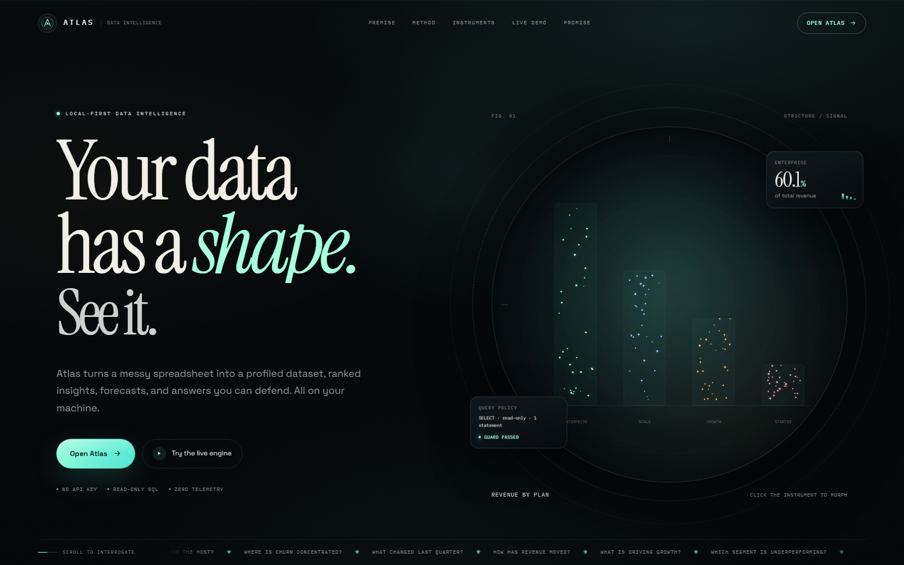
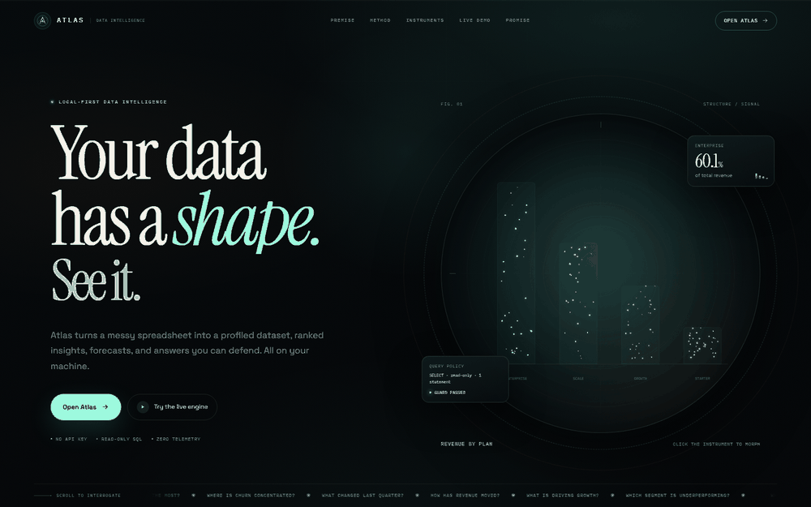
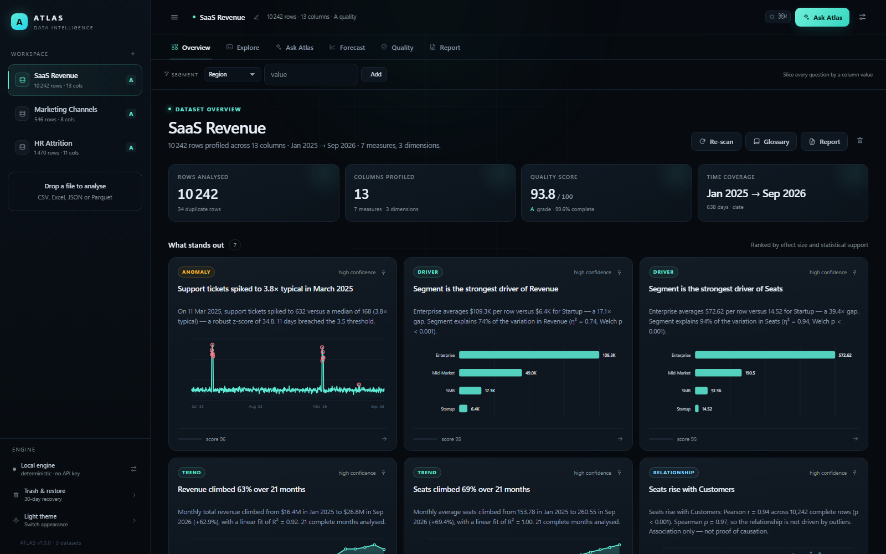
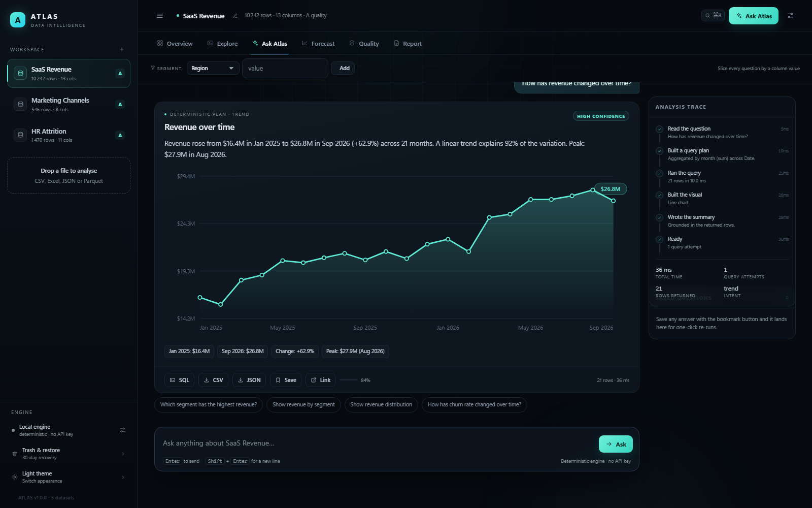

# Atlas

> **Ask your data a question. Watch it think. Get an answer you can defend.**

Atlas is a local-first AI data analyst that runs on your machine and turns a messy spreadsheet into a profiled dataset, ranked insights, forecasts, and an offline report you can hand to someone else.

It works **without an API key**. When you do connect a model, Atlas uses it to improve prose or propose SQL — never to invent a number.



*The landing page at `/`. The analyst workspace opens at `/app` — the live demo on the landing page runs against the same local engine.*



*A short loop: landing page, live demo, workspace, Ask Atlas, forecast, and the command palette.*

---

## Why Atlas is different

Most "AI analyst" demos are a chat box around a language model. Atlas is built the other way around:

| Principle | What it means in practice |
| --- | --- |
| **Deterministic first** | A rule-based NL→SQL engine answers common analytical questions with no model, no network, and no key. The LLM is optional, not the foundation. |
| **Grounded by construction** | Every sentence is generated from the returned rows. The narrator emits a `facts` dictionary; optional LLM prose is rejected if it introduces a number that is not in that dictionary. |
| **Read-only by construction** | DuckDB opens with `enable_external_access=false`; the SQL guard allows one `SELECT`/`WITH` statement, blocks file/network functions and DDL/DML, caps rows, and runs under a watchdog timeout. |
| **Quality before answers** | Completeness, uniqueness, consistency, and validity are scored on ingest. PII, spelling drift, outliers, and duplicate rows are surfaced before they distort a conclusion. |
| **Explainable by default** | Each answer ships with its SQL, execution trace, row count, caveats, and a calibrated confidence score. |
| **Local-first** | One process, one DuckDB file, zero telemetry. Your data never leaves the machine unless you configure an LLM endpoint yourself. |

---

## Quickstart

Requires Python 3.11+.

```bash
git clone <your-repo> atlas
cd atlas

python -m venv .venv
# Windows
.venv\Scripts\activate
# macOS / Linux
source .venv/bin/activate

pip install -e ".[dev]"
atlas
```

Open **http://127.0.0.1:8050** for the landing page, or go straight to **http://127.0.0.1:8050/app** for the analyst workspace.

On first launch Atlas seeds three deliberately messy demo datasets — SaaS revenue, marketing channels, and HR attrition — so every view has something real to show. The landing page includes a live Ask Atlas demo that calls the same deterministic engine.

```bash
# equivalent, if you prefer uvicorn
python -m uvicorn atlas.app:app --host 127.0.0.1 --port 8050
```

Use a different data directory or port:

```bash
atlas --data-dir ./my-data --port 9000
```

Back up, restore, or watch a folder:

```bash
atlas backup --out atlas-backup.zip
atlas restore --from atlas-backup.zip
atlas watch --dir ./inbox --once
```

---

## Two surfaces

| Route | What it is |
| --- | --- |
| `/` | The landing page: editorial dark design, locally bundled fonts, an animated data instrument, and a live Ask Atlas demo against the seeded dataset. |
| `/app` | The analyst workspace: Overview, Explore, Ask Atlas, Forecast, Quality, and Report. |

The landing page ships inside the Python package. It makes no external requests — no CDN, no analytics, no font host.

Workspace conveniences:

- `Ctrl/Cmd+K` opens a command palette for views, datasets, and questions.
- Deep links look like `#/d/saas-revenue/ask?q=...&f=region:EMEA`, so a filtered answer can be bookmarked or shared with a colleague on the same machine.
- Questions can be saved and insights pinned. Both live in `localStorage` only.
- Light and dark themes share the same design tokens.
- Deleted datasets sit in a 30-day trash with an undo toast and an explicit permanent delete.

---

## A tour



| View | What it does |
| --- | --- |
| **Overview** | Profile, quality grade, time coverage, KPI cards, ranked insights, editable description/tags, a column glossary, and a narrative read of the dataset. |
| **Explore** | A read-only DuckDB console with table, chart, and CSV/JSON output. Every query is validated, capped, and time-limited. |
| **Ask Atlas** | Natural-language questions with live SSE trace: understand → plan → execute → shape → narrate. Returns SQL, chart, highlights, caveats, confidence, follow-up questions, and supports multi-turn context and clarification choices. |
| **Forecast** | Candidate models (Holt-Winters, seasonal naive, linear), rolling-origin backtest, calibrated intervals, calendar effects, date exclusions, and anomaly sensitivity. |
| **Quality** | Dimension scores, issue list with severity and remediation, missingness map, PII flags, and duplicate detection. |
| **Report** | A self-contained HTML report with inline SVG charts, four templates, custom brand/title, section toggles, PII redaction, a glossary, a forecast section, an evidence appendix, and clean PDF printing. |

Ask Atlas in action:



Beyond the views, the HTTP API also exposes comparison, cohort-retention, and
relationship analysis (`/api/datasets/{id}/compare`, `/cohorts`,
`/relationships`). See [docs/api.md](docs/api.md).

---

## How an answer is made

```
question
   │
   ▼
┌─────────────┐   deterministic parser (nlsql.py)
│  understand │──────────────┬──────────────┐
└─────────────┘              │              │
                             ▼              ▼
                    ┌──────────────┐  ┌──────────────┐
                    │ rule-based   │  │ LLM fallback │  (only if configured
                    │ plan + SQL   │  │ JSON contract│   and rules fail)
                    └──────┬───────┘  └──────┬───────┘
                           └────────┬────────┘
                                    ▼
                          ┌───────────────────┐
                          │ read-only sandbox │  validate → limit → watchdog
                          └────────┬──────────┘
                                   ▼
                          ┌───────────────────┐
                          │ grounded narrator │  facts + numbers from rows
                          └────────┬──────────┘
                                   ▼
                    trace · SQL · chart · narrative · confidence
```

The model path is deliberately narrow. A model may propose a single JSON object containing SQL, a chart type, and a rationale. The SQL still goes through the same guard, and the narrative still comes from the result rows.

---

## What gets detected on ingest

- Encoding drift (UTF-8, UTF-16, Windows-1252 fallback) and delimiters (`,` `;` tab `|`, sniffed)
- CSV, TSV, JSON, Excel (`.xlsx`, optional `openpyxl`), Parquet (optional `pyarrow` or DuckDB)
- Multi-sheet Excel with an explicit sheet choice, header-row overrides, and nested JSON flattened or addressed by path
- A pre-ingest preview so you can confirm headers, types, and row counts before committing
- Business-formatted numbers: `$1,234.50`, `(12.4)` → `-12.4`, `7.2%`, `1 234`, `€`, `£`, `¥`
- Dates and timestamps, with grain detection (day/week/month/quarter/year)
- Semantic roles: currency, percentage, count, date, category, boolean, identifier, email, phone, SSN, credit card, URL, and PII
- Quality signals: nulls, duplicates, spelling/case drift, robust outliers, out-of-range percentages and counts, constant and high-cardinality columns

---

## The SQL sandbox

Defense in depth, not a single regex:

1. **DuckDB-level**: `enable_external_access=false` — no filesystem or HTTP access from SQL.
2. **Statement-level**: one `SELECT` or `WITH` statement; comments are stripped; string literals and quoted identifiers are masked before keyword scanning so `WHERE note = 'drop table'` is not a false positive.
3. **Keyword/function blocklist**: DDL, DML, `ATTACH`, `COPY`, `PRAGMA`, `read_csv*`, `read_parquet`, `glob`, `duckdb_settings()`, `information_schema`, `pg_catalog`, and similar.
4. **Row cap**: results are wrapped with a `LIMIT` unless the query already has one.
5. **Time cap**: a watchdog interrupts long queries; the API returns a clear timeout instead of hanging.
6. **Upload cap**: bounded 1 MB-chunk spooling to disk, a magic-byte allowlist, and atomic rename into the raw archive.
7. **Browser boundary**: a strict Content Security Policy plus Origin and `Sec-Fetch-Site` checks on state-changing requests.

The same guard protects Ask Atlas, the Explore console, forecast inputs, and report generation.

---

## Forecasting and anomaly detection

Atlas implements its own time-series routines (NumPy only):

- **Candidate models**: Holt-Winters additive (grid-searched level/trend/seasonal smoothing, inferred seasonal period), seasonal naive, and linear trend — compared on a holdout.
- **Rolling-origin backtest** so the reported error reflects more than one lucky split.
- **Metrics and intervals**: MAE, MAPE, R², holdout points, and a calibrated forecast band.
- **Calendar effects** and **date exclusions** for known closures or one-off events.
- **Anomalies**: robust z-scores on a weekly-adjusted baseline with adjustable sensitivity, so every Sunday is not flagged as a spike.

---

## Optional LLM

Open **Settings** in the UI, or set environment variables:

```bash
export ATLAS_LLM_PROVIDER=ollama          # none | openai | ollama
export ATLAS_LLM_MODEL=qwen2.5-coder:7b
export ATLAS_LLM_BASE_URL=http://localhost:11434/v1
# export ATLAS_LLM_API_KEY=...            # for hosted OpenAI-compatible APIs
```

Any OpenAI-compatible endpoint works: OpenAI, Ollama's `/v1`, vLLM, LM Studio, or a gateway. Settings are stored locally in `data/settings.json`.

What the model can and cannot do:

- **Can** propose SQL when the deterministic parser has no plan.
- **Can** polish the narrative.
- **Can** ask a clarifying question, and the UI offers selectable choices.
- **Is retried** with backoff, and constrained by per-request token and cost budgets.
- **Cannot** introduce a number that is not in the grounded facts. The polish is checked and discarded if it fails.
- **Cannot** bypass the SQL guard or read files. Proposed SQL is schema-validated and planned with `EXPLAIN` before it runs.

---

## Docker

```bash
docker build -t atlas .
docker run --rm -p 8080:8080 -v atlas-data:/data atlas
```

Open **http://127.0.0.1:8080** for the landing page, or **http://127.0.0.1:8080/app** for the workspace. The container stores its DuckDB file and uploads in the `/data` volume.

---

## Tests

```bash
pip install -e ".[dev]"
python -m pytest
python benchmarks/run.py
npm test                       # Node tests for the frontend helpers
$env:ATLAS_E2E="1"; python -m pytest tests/e2e   # Playwright, opt-in
```

The suite covers:

- closed-form statistical values (normal, t, F, chi-square tails) without SciPy
- Pearson/Spearman, Welch ANOVA, Cramér's V, OLS trend, autocorrelation
- the deterministic NL→SQL parser on the seeded SaaS dataset (21-case benchmark)
- SQL guard bypass attempts, comments, literals, catalog probes, and row limiting
- messy ingest: currency, parentheses negatives, percentages, dates, delimiters, multi-sheet Excel, nested JSON
- FastAPI endpoints, SSE streaming, upload/rename/delete, trash/restore, filters, forecast, anomalies, glossary, auth, and self-contained report HTML
- property-based invariants for CSV round-trips, quality bounds, number parsing, and filter escaping
- browser flows, axe accessibility (no critical/serious violations), and PDF text extraction for the report

Static JavaScript is syntax-checked in CI with `node --check`.

---

## Docs

| Document | Contents |
| --- | --- |
| [docs/architecture.md](docs/architecture.md) | Process model, package map, Ask pipeline, storage schema, security boundaries, testing, deployment |
| [docs/api.md](docs/api.md) | Local HTTP API reference with payloads and examples |
| [docs/openapi.json](docs/openapi.json) | Exported OpenAPI 3.1 schema (regenerate with `python scripts/export_openapi.py`) |
| [docs/threat-model.md](docs/threat-model.md) | Assets, trust boundaries, and mitigations |
| [SECURITY.md](SECURITY.md) | How to report a vulnerability |
| [CONTRIBUTING.md](CONTRIBUTING.md) | Development workflow, tests, and versioning |

Swagger UI and ReDoc are deliberately disabled at runtime because they pull
assets from a CDN. `/openapi.json` is served locally.

---

## Configuration

| Variable | Default | Purpose |
| --- | --- | --- |
| `ATLAS_DATA_DIR` | `./data` | DuckDB file, raw uploads, settings |
| `ATLAS_MAX_UPLOAD_MB` | `128` | Upload size cap |
| `ATLAS_MAX_ANALYSIS_ROWS` | `300000` | Row cap for profiling/insights |
| `ATLAS_QUERY_TIMEOUT` | `8` | Seconds before a query is interrupted |
| `ATLAS_ROW_LIMIT` | `1000` | Default result row cap |
| `ATLAS_AUTH_TOKEN` | — | Require this token for non-loopback clients |
| `ATLAS_LOG_JSON` | `0` | Emit one JSON object per log line |
| `ATLAS_LLM_PROVIDER` | `none` | `none`, `openai`, or `ollama` |
| `ATLAS_LLM_MODEL` | — | Model name |
| `ATLAS_LLM_BASE_URL` | — | OpenAI-compatible base URL |
| `ATLAS_LLM_API_KEY` | — | Optional key |
| `ATLAS_LLM_TEMPERATURE` | `0.2` | Sampling temperature |
| `ATLAS_MAX_TOKENS` | `8000` | Per-request token budget |
| `ATLAS_COST_BUDGET_USD` | `0` | Optional per-request cost ceiling |
| `ATLAS_REDACT_PII` | `true` | Redact PII in exported reports |

When `ATLAS_AUTH_TOKEN` is set and the client is not on loopback, open
`http://host:8050/?token=...` once. Atlas exchanges it for an HttpOnly SameSite
cookie and redirects to a clean URL.

---

## Project layout

```
atlas/
├─ atlas/
│  ├─ app.py                 FastAPI routes, SSE, security middleware, demo seeding
│  ├─ config.py              env + settings resolution
│  ├─ logging_setup.py       text or JSON logs with request IDs
│  ├─ __main__.py            `atlas` CLI: serve, backup, restore, watch
│  ├─ core/
│  │  ├─ ingest.py           bytes → clean, typed DataFrame, sheets/headers/JSON paths
│  │  ├─ semantics.py        meaning, PII, and business-format detection
│  │  ├─ profile.py          column stats, correlations, time coverage
│  │  ├─ quality.py          four-dimension quality score + issues
│  │  ├─ nlsql.py            deterministic NL → SQL
│  │  ├─ sqlguard.py         read-only SQL policy
│  │  ├─ store.py            DuckDB persistence, migrations, trash, watchdog
│  │  ├─ agent.py            the analyst loop (sync + streaming)
│  │  ├─ narrator.py         grounded prose + facts
│  │  ├─ filters.py          safe `column = value` segment filters
│  │  ├─ analysis.py         ranked, deduplicated insights
│  │  ├─ compare.py          period-over-period comparison + waterfall
│  │  ├─ cohort.py           cohort retention
│  │  ├─ relationships.py    association discovery
│  │  ├─ forecast.py         candidates, backtest, intervals, calendar effects
│  │  ├─ anomaly.py          weekly-adjusted robust z-scores
│  │  ├─ stats.py            NumPy-only statistical primitives
│  │  ├─ charts.py           server-side SVG for reports
│  │  └─ report.py           self-contained HTML report
│  └─ static/                landing page + zero-build app interface
├─ datasets/                 demo CSVs + generator
├─ docs/                     architecture, API, threat model, screenshots
├─ scripts/                  OpenAPI export + version bump
├─ tests/                    pytest suite + opt-in Playwright e2e
├─ benchmarks/               deterministic NL→SQL benchmark
└─ Dockerfile
```

---

## Design notes and limits

- **Single-table analysis.** Atlas profiles and queries one dataset at a time. Cross-dataset joins are intentionally out of scope.
- **The deterministic parser is honest.** If a question asks for a grouping that does not exist, or two breakdowns at once, it refuses with a hint instead of returning a confident half-truth.
- **Loopback by default.** Atlas binds to `127.0.0.1`. For a non-loopback bind, set `ATLAS_AUTH_TOKEN`; otherwise put it behind a reverse proxy with auth.
- **Deletion is reversible for 30 days.** Permanent delete is a separate, explicit action.
- **Forecasting is a planning aid, not a guarantee.** Check the backtest metrics and the interval band.
- **The report is static on purpose.** No JavaScript means it can be emailed, archived, and printed without a runtime.

---

## License

MIT. Built as a demonstration that an AI analyst can be useful, transparent, and local at the same time.
